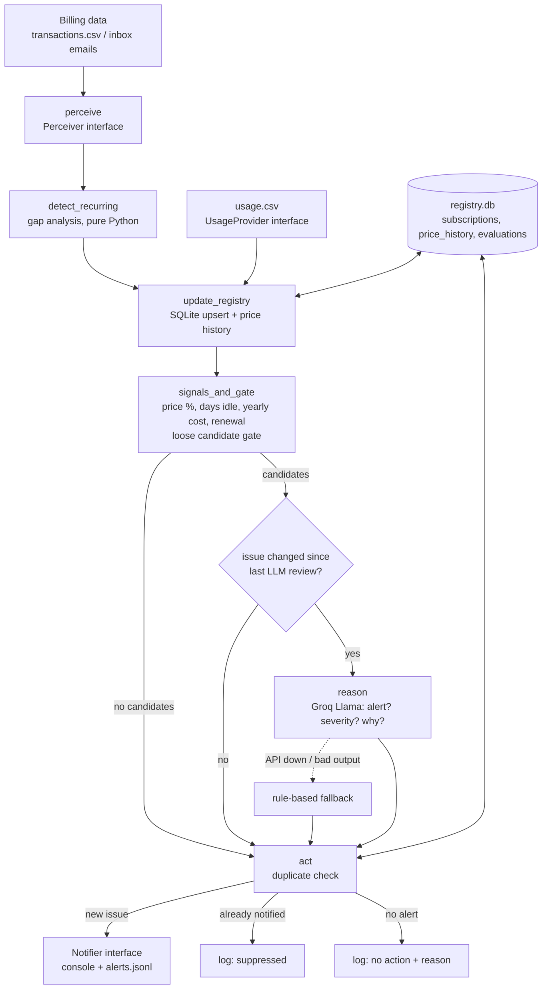

# Subscription Watchdog Agent

An autonomous agent that watches your recurring payments, builds a profile of
each subscription, tracks price changes, and decides **on its own** when
something genuinely deserves your attention. It stays silent otherwise.

> Code handles **facts and math**. The LLM handles **judgment**. The LLM never invents numbers.

## Setup

Requires Python 3.11+.

```bash
python3 -m venv .venv
source .venv/bin/activate
pip install -r requirements.txt
cp .env.example .env          # then put your Groq key in .env
python data/generate_mock_data.py
```

`.env` (never committed):

| Variable | Default | Meaning |
|---|---|---|
| `GROQ_API_KEY` | – | Your key from console.groq.com |
| `GROQ_MODEL` | `openai/gpt-oss-120b` | Any Groq chat model |
| `POLL_INTERVAL_SECONDS` | `60` | Loop mode poll period |

No key? The agent still runs using a rule-based fallback (see *Failure handling*).

## Run the demo

```bash
python -m agent.main --once              # one pass, with the LLM
python -m agent.main --once --no-llm     # one pass, rule-based fallback only (for comparison)
python -m agent.main --once --inbox      # also read data/inbox/*.eml|*.txt billing emails
python -m agent.main                     # poll forever; re-runs only when the data or date changes
python -m agent.main --once --today 2026-12-01   # time-travel
pytest -q                                # unit tests (no network, no LLM)
```

Demo reference date is fixed (`2026-10-29` in `agent/config.py`) so results are
reproducible. Use `--real-date` to use the system clock.

Where to look afterwards:
- Console: every step and **why** each decision was made
- `logs/watchdog.log`: the same, timestamped
- `logs/alerts.jsonl`: one JSON record per alert actually sent
- `data/registry.db`: the SQLite registry (`sqlite3 data/registry.db "select * from subscriptions"`)

## Dashboard (optional)

A small local web page, standard library only (no Flask, no build step):

```bash
python -m agent.ui          # then open http://127.0.0.1:8000
```

It shows every subscription with its signals, whether it was reviewed, the
decision and its reason, the alerts sent, and the step-by-step decision log of
the last run. Controls: reference date, "Use LLM" toggle (off = rule-based
comparison), "Include inbox emails", **Run agent**, and **Reset demo**.

It adds no logic of its own: it reads the same SQLite registry the agent writes
(`agent/ui.py`, page in `agent/web/index.html`). It binds to `127.0.0.1` only,
and POST endpoints require a custom header so other web pages cannot trigger
runs.

## Architecture



| Module | Job | LLM? |
|---|---|---|
| `perceive.py` | CSV and email parsing into `Transaction` | No |
| `recurring.py` | Cadence detection from gaps between charges | No |
| `registry.py` | SQLite storage, idempotent upserts | No |
| `signals.py` | Signal maths, candidate gate, issue fingerprints | No |
| `reasoner.py` | Judgment: alert or not, severity, one-line reason | **Yes** |
| `graph.py` | LangGraph wiring and routing | No |
| `notifier.py` | Delivery channels behind an interface | No |
| `loop.py` | Polling, re-run only on changed inputs | No |

## The key design idea: a loose gate, then judgment

Two threshold levels live in `agent/config.py`:

- **Candidate gate (loose):** price up 5%+, unused 60+ days, or yearly renewal within 21 days.
  Crossing it does *not* mean alert. It means "send this to the LLM".
- **Strict level (obvious):** price up 25%+, unused 120+ days. Passed to the LLM as a
  hint, and used by the offline fallback.

Example: StreamPlus is up 10% and unused for 95 days. Neither crosses a strict
rule, so a rule-based tracker stays silent. The LLM weighs the two together and
can decide it is worth a nudge. That weighing of combined, context-dependent
signals is the agentic part.

## Failure handling and safeguards

| Risk | What happens |
|---|---|
| Groq rate limit (429), timeout, 5xx | Exponential backoff retries (honours `retry-after`), up to `LLM_MAX_RETRIES` |
| Auth / bad request error | No retry (pointless); straight to fallback |
| LLM returns malformed JSON or wrong schema | One correction round (error fed back), then fallback |
| LLM cites a number not in the supplied facts | Rejected like bad JSON. Every number in `reason` must match a computed signal |
| LLM changes which merchant it is talking about | Impossible: code overwrites `merchant` after parsing |
| Fallback | Rule-based decision tagged `[rule-based fallback: …]` and `source=fallback`, so the agent never goes silent |
| Duplicate alerts | Each issue gets a *fingerprint* (e.g. `price:499->799`, `unused_since:2026-06-13`, `renews:2026-11-12`). Same fingerprint means no LLM call and no new notification. A new price, new last-use date or new renewal date means a new issue |
| Notifier fails (e.g. email down) | Alert is *not* marked as sent, so it is retried next run |
| LLM was down, fallback alerted, LLM returns | LLM re-reviews, but the user is not notified twice for the same issue |
| Usage data missing | `None`, not 0. "No data" is never treated as "unused" |
| Bad run in loop mode | Logged and retried next tick; the loop does not die |

## How this differs from a normal expense tracker

| Expense tracker | Watchdog agent |
|---|---|
| Shows you a list or chart when **you** open it | Runs by itself and **pushes** only when something matters |
| Fixed rules ("alert if > X") or none at all | Rules only *shortlist*; an LLM judges combinations like small hike + long inactivity |
| Treats every charge the same | Builds a per-subscription profile: cadence, price history, usage |
| Re-reports the same thing every time | Remembers what it already told you and only speaks on change |
| Opaque | Logs the facts and the *reason* for every decision |
| Breaks if a service is down | Degrades to rules instead of going silent |

## Mock data scenarios

| Service | Situation | Expected |
|---|---|---|
| StreamFlix | ₹499 → ₹799 (+60%) | Alert |
| FitZone Gym | Unused 138 days | Alert |
| CloudDrive | ₹149 → ₹159 (+6.7%), actively used | Candidate, LLM should decline |
| PrimeShow Annual | Yearly, renews in 14 days | Low-severity heads-up |
| Spotifree | Stable, used daily | Skipped (no LLM call) |
| StreamPlus | +10% and unused 95 days | **Grey zone: LLM judges** |
| CodeAssist | USD 10/month (mock rate ₹85) | Currency handling; skipped |
| NewsDaily | Only in `data/inbox` emails, no usage data | Detected; never a candidate |

## Extending

- **New notifier** (email, desktop): subclass `Notifier` in `agent/notifier.py`, add to `MultiNotifier` in `main.py`.
- **Real usage data:** implement `UsageProvider.last_used(service)`.
- **New data source:** implement `Perceiver.fetch()`.

## Known limitations (good viva answers)

- Detection needs 3 charges for weekly/monthly (2 for yearly), so a brand-new subscription is spotted after about one cycle.
- Merchant names must match exactly across charges; real bank descriptors would need normalisation.
- FX is a fixed mock rate; a real system should compare prices in the original currency.
- If the same service appears in both the CSV and the inbox, charges are not de-duplicated.
- Polling, not push: new data is noticed at the next poll tick.
